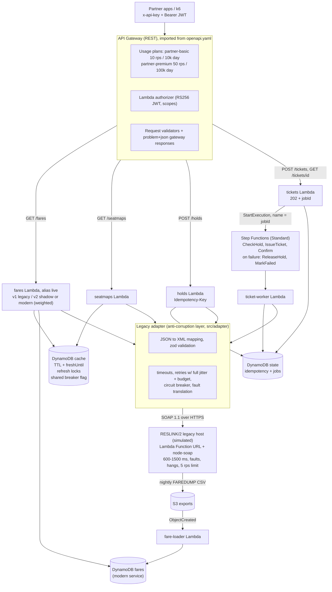

# Architecture and design decisions

## Request paths

Every piece above is in Terraform (`infra/`) and traced with X-Ray (API Gateway stage,
Lambdas via Powertools Tracer, a subsegment per legacy SOAP call, Step Functions tracing).

## Where things live

| Concern | Code |
|---|---|
| Legacy host (the thing we integrate with) | `src/legacy/` (WSDL, node-soap server, fault injection, FAREDUMP export) |
| Anti-corruption layer | `src/adapter/codes.ts` (value mapping), `xml.ts` (envelopes), `client.ts` (typed operations) |
| Resilience | `src/resilience/retry.ts`, `circuit-breaker.ts` |
| Cache | `src/cache/read-through.ts` |
| Use cases | `src/app/` (fares incl. shadow/modern modes, seat maps, holds, ticketing, idempotency) |
| Lambda entry points | `src/handlers/` |
| Contract | `openapi/openapi.yaml` |
| Workflow | `infra/sfn/ticketing.asl.json` (also executed locally by `src/local/asl-runner.ts`) |

## Decisions

### Anti-corruption layer
RESLINK speaks fixed-width upper-case codes (`"YYZ  "`, `"AC0105"`), `DDMMMYY` dates, integer
cents in zero-padded strings, `SURNAME/GIVEN` names, row-encoded seat maps (`"012AXHA-A"`) and
numeric fault codes inside `soap:Fault/detail`. All of that is translated in `src/adapter` and
nowhere else: the rest of the gateway, the OpenAPI contract and every client see ISO dates,
integer `priceCents`, `AC105`, `12A` and RFC 9457 problems. If the legacy host is replaced
(which the strangler fig is doing), only the adapter's callers change, not the API.

The adapter also refuses to trust the host: input is validated with zod *before* a request is
built, and responses are validated as well-formed XML before parsing. That second check was
added after a test showed fast-xml-parser happily parsing a truncated body into a quote of
429 cents instead of 42 900.

### Which operations are retried
| Operation | Retry policy | Why |
|---|---|---|
| GetFareQuote, GetSeatMap, GetHoldStatus | Any retryable fault or timeout, 3 attempts, 2 s each, 5 s budget | Reads are idempotent |
| HoldSeat | Only fault 9001 ("busy, did nothing") | Not idempotent: after a timeout we cannot know whether the seat was held, so a blind retry could hold two seats |
| IssueTicket, ReleaseHold | Retried by Step Functions (not in code) | The host deduplicates by hold id, so these are idempotent |

Retries use full jitter (`random(0, min(cap, base * 2^n))`) so a fleet of Lambdas does not retry
in lockstep, and every retry loop has a **time budget**: an attempt only starts if it can get at
least 250 ms of what is left, and its timeout is clipped to the remainder. Without the budget,
retries pile up behind an outage (a retry storm) and the client's own timeout fires anyway.

### Circuit breaker state in serverless
Each Lambda instance keeps a rolling window of outcomes, but instance-local state is not
enough: every instance must discover the outage separately, and every *new* instance (and
there are more of them during an outage, because requests are slower) starts closed. So when
an instance trips the breaker it also writes `BREAKER#reslink {openUntil}` to DynamoDB; all
instances read it (cached ~1 s, so it costs one read per instance per second, not per
request) and back off together. After the cool-down, a conditional-write lease lets exactly
one instance send the half-open probe. The cost is a DynamoDB read per instance-second and
up to ~1 s of lag; if DynamoDB itself is unavailable the breaker falls back to local state
rather than failing requests. `test/unit/resilience.test.ts` has a test that shows the cold
instance problem directly.

### Stale-while-revalidate vs. a plain TTL
With a plain TTL, every popular key expires at some moment and all concurrent requests for it
miss together, sending a burst to a host that allows 5 req/s. Here an entry has `freshUntil`
(fares 5 min, seat maps 15 s) and a longer DynamoDB `ttl` (fares 24 h, seat maps 5 min). Past
`freshUntil` the stale value is served immediately and **one** refresh runs, guarded by a
conditional write on `LOCK#<key>`. On Lambda the refresh is an async self-invocation of the
same function version, because an in-process promise would freeze with the sandbox once the
response is returned. When the host is down, entries past `freshUntil` (and even past `ttl`,
since DynamoDB deletes lazily) are served with `Warning: 110` and an `Age` header.

Seat maps get a far shorter freshness window than fares because every hold changes them.
A successful hold also deletes that flight's cached seat map.

DynamoDB was chosen over API Gateway's built-in cache because the latter is billed per hour
while it exists, cannot do stale-while-revalidate or stale-on-error, and caches per stage
rather than per business key.

### Asynchronous ticketing
`IssueTicket` takes 5-20 s on the host. `POST /tickets` therefore returns `202 Accepted` with a
job id and a `Location` header and starts a Step Functions **Standard** execution whose name is
the job id (derived from client + `Idempotency-Key`), so a retried POST cannot start a second
execution. Retries with backoff and jitter, the per-task timeouts, and the compensation path
(`ReleaseHold`, then `MarkFailed` with a reason) are all declared in the state machine.
Standard rather than Express because executions run up to a few minutes, need exactly-once
start semantics by name, and benefit from the visual execution history when debugging.

### Idempotency
`POST /holds` and `POST /tickets` require an `Idempotency-Key`. The first request claims
`IDEM#<client>#<key>` with a conditional write; a replay with the same body gets the stored
response (`idempotent-replayed: true`), a different body gets 422, a concurrent duplicate gets
409. Business rejections (seat taken) are stored and replayed; upstream failures (5xx) release
the key so the client can retry.

### Strangler fig
See [migration.md](migration.md).

### API management
Two usage plans (basic 10 rps / burst 20 / 10 000 per day, premium 50 rps / burst 100 / 100 000
per day), each with its own API key. These are the same concepts Apigee calls *API products*
and *quota/spike-arrest policies*, and MuleSoft API Manager calls *SLA tiers* with *rate-limiting
policies*. Access logs are JSON lines with the API key id and principal, and a log metric filter
turns 429s into a per-key CloudWatch metric.

### Bulkhead and admission control
The first full load test failed badly: with a cold cache at 20 req/s, cache misses exceeded
the host's 5 req/s limit, the host answered `9001 busy`, the gateway *retried* (adding load),
and the breaker counted "busy" as "unhealthy" and tripped, so **63% of requests failed** and
"retries + breaker" did worse than no protection at all. A textbook retry storm against a
rate-limited dependency. Two fixes (`src/resilience/rate-limiter.ts`):

1. **Gateway-side admission control.** Every legacy call, including retries and background
   refreshes, takes a slot in a fleet-wide one-second window first (an atomic `ADD` counter in
   DynamoDB, so every Lambda instance shares one 5 req/s budget). A call that finds the window
   full waits for the next one within its time budget, then is shed with `503 upstream-busy`
   without touching the host.
2. **`9001` is backpressure, not ill health.** It no longer counts toward tripping the breaker.

On top of that, the Lambdas that call the host can have **reserved concurrency** (Terraform
variable `bulkhead_concurrency`), which caps how many requests can wait on the host at once and
protects the rest of the account's concurrency from a slow upstream. It is off by default
because new AWS accounts often have a concurrency limit of 10, which leaves nothing to reserve.

### Security
- JWT (RS256) Lambda authorizer; scopes `fares:read`, `holds:write`, `tickets:write`. The
  returned policy covers every route the scopes allow, because API Gateway caches it per token.
- API key per partner; usage plans enforce rate and quota.
- Legacy credentials in SSM Parameter Store **SecureString**, read once per container and
  cached (refreshed every 15 min).
- One IAM role per function, scoped to the specific tables, parameters and state machine.
- TLS only (API Gateway and Lambda Function URLs do not serve plain HTTP).
- CI deploys through GitHub OIDC; there are no long-lived AWS keys anywhere.
