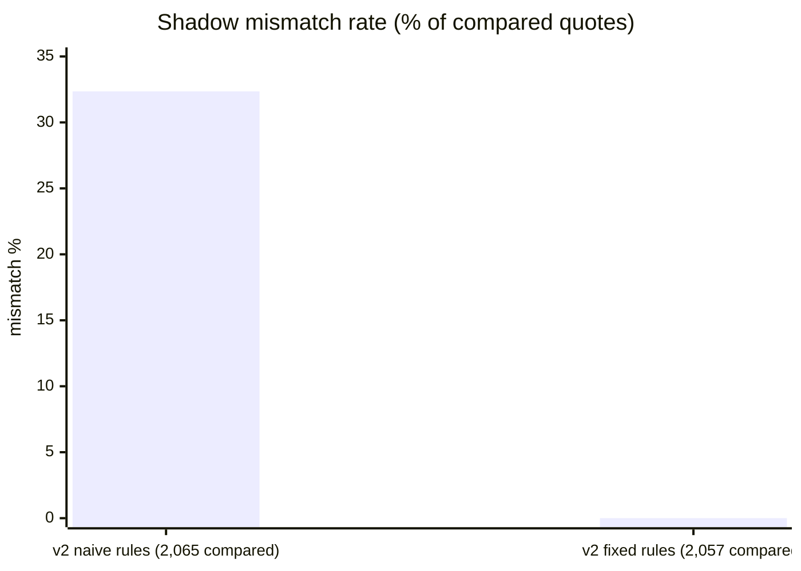

# Strangler-fig migration of `GetFareQuote`

The strangler fig pattern replaces a legacy system one piece at a time while it keeps running.
Here the piece is fare quoting: the most-called operation, read-only, and backed by data the
legacy host already exports every night.

## The modern fare service (v2)

- The legacy host's nightly **FAREDUMP** job writes a CSV of fares for the next 120 days to S3
  (`src/legacy/export.ts`; on AWS an EventBridge schedule at 03:00 Toronto time).
- An S3 `ObjectCreated` event triggers the loader Lambda, which batch-writes the rows into the
  `fares` DynamoDB table (`src/handlers/fare-loader.ts`).
- v2 answers `GET /fares` from that table: one `GetItem`, no SOAP, no 5 req/s limit
  (`src/modern/fare-service.ts`).

The same Lambda serves every mode; the mode is a per-version environment variable
(`FARE_MODE=legacy | shadow | modern`), so a *Lambda version* is a migration stage and the
`live` alias decides who gets which stage.

## Step 1: shadow mode

In shadow mode the function calls **both** systems for every request, **returns the legacy
answer**, and compares the two on price, currency and flight number. Every difference is
logged as a structured `fare_shadow_mismatch` event and counted (`FareShadowCompared`,
`FareShadowMismatch`, `FareShadowMismatchField{field}` metrics). Clients see no change.

### What the comparison found

The first version of v2 read the feed at face value. Shadow traffic (10 req/s, realistic mix)
showed **32.35%** of 2,065 compared quotes disagreeing:

| Field | Mismatches | Cause |
|---|---|---|
| `priceCents` | 520 | Friday and Sunday departures carry a weekend surcharge. The feed exports it as a **separate column** (`weekend_surcharge_cents`); the online system folds it into the amount. v2 ignored the column. |
| `missing` | 148 | Business class is quoted online as **`J`** but filed in the feed as **`C`** (an old internal re-coding). v2 looked up `J` and found nothing. |

Both are typical of legacy data feeds: the export was designed for another consumer, and its
conventions differ from the online system's in ways nobody wrote down.

After the fixes (add the surcharge column, map `J` to feed class `C`), the same shadow run
compared 2,057 quotes with **0 mismatches**:



Both rule sets are kept (`MODERN_FARE_RULES=naive|full`) so this result can be reproduced:
`npm run experiments -- --target local --only shadow`.

### The irreducible floor

The legacy host's revenue management re-files a small share of fares **during the day**, after
the nightly export (simulated at 0.05%). v2 cannot see those until the next export, so in
production the mismatch rate never reaches exactly zero; that is why the canary alarm threshold
is **0.1%**, not 0. In these 2,057 requests none of the re-filed fares happened to be quoted.
`test/unit/modern-fares.test.ts` checks the floor over the entire export (every route, class and
day) and keeps it under 0.2%.

## Step 2: canary

With mismatches under the threshold, a new version with `FARE_MODE=modern` is published and the
`live` alias shifts traffic to it with **Lambda weighted routing**:

```
npm run canary -- prepare --function lrg-dev-fares --mode modern --rules full   # -> version N
npm run canary -- shift --function lrg-dev-fares --to N --steps 10,50,100 --bake 120 \
    --alarms lrg-dev-api-5xx-over-1pct,lrg-dev-fare-shadow-mismatch-over-0.1pct
```

After each step's bake time the script checks the two CloudWatch alarms; if either is in
`ALARM`, the alias goes straight back to the stable version and the script exits non-zero.
In `modern` mode, 10% of requests are still checked against legacy (sampled verification), so
the mismatch alarm keeps working after shadow mode ends.

Measured on the local harness (which emulates the weighted alias), 10 req/s, 120 s per step:

| Step | Requests | Served by v2 | Errors |
|---|---|---|---|
| 0% (baseline) | 1,200 | 0% | 0 |
| 10% | 1,200 | 8.3% | 0 |
| 50% | 1,200 | 50.3% | 0 |
| 100% | 1,200 | 100% | 0 |

No rollback was triggered.

## What changed for the legacy host

At 100% on v2, fare quotes no longer touch RESLINK at all except for the 10% verification sample
(which mostly hits the cache), so the host's 5 req/s budget is left for what only it can do:
holds and ticketing. That is the point of strangling the busiest read path first.

## Rollback

`npm run canary -- rollback --function lrg-dev-fares` points the alias back at the stable
version immediately; no deployment, no data migration, because v1 never stopped working.
